# agentmap

agentmap is a live dashboard for a portrait side monitor. It shows what every Claude Code and Codex thread of one [T3 Code](https://github.com/pingdotgg/t3code) project does now: which files each agent works in, what it thinks and says, which tickets it works on, and what happened in the last hours. You watch it. You do not operate it. A hover on any mark lights every linked mark on the page.

| Day | Evening |
|---|---|
| 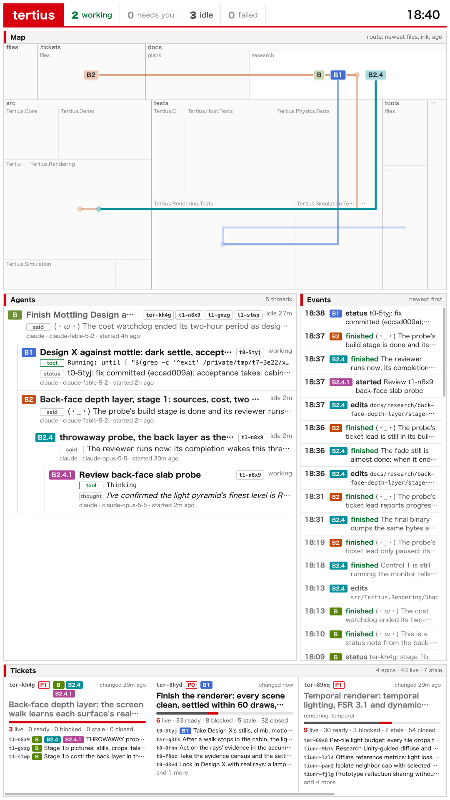 | 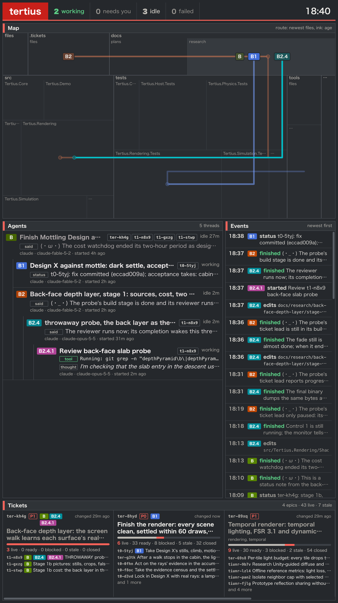 |

All screenshots show the live board of [tertius](https://github.com/alexispurslane/tertius), a game engine that a team of agents builds.

## Features

### The project map

The map is a treemap of the project, two levels deep. Each directory gets an area in proportion to how much information its files hold: their compressed (gzip) size. Prose files, such as Markdown, count a quarter of their size, and data files, such as JSON and logs, count a half. So repetitive test code takes less room, and dense source code takes more.

Each agent thread is a dot with a tag, such as `B2`, in the area of the file that it touched last. A route in the agent's color runs through the areas of its recent files, oldest to newest. Each segment fades in real time and is gone after an hour, so the map shows where the work moves. An area where an agent works now has a white ground.

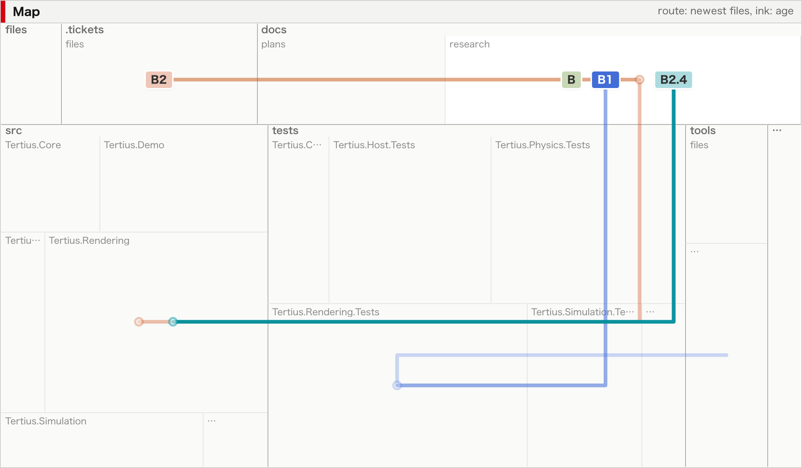

### The agent tree

The tree has one card per thread. A subagent's card sits inside the card of the thread that started it. A card shows:

- The tag, the title and the state: working, needs you, idle for a time, or failed.
- A badge for each ticket that the thread works on.
- The tool call that runs now.
- The newest thought, message or status line.
- The provider, the model and the start time.

A click on a card's title opens the thread in the T3 Code app.

A card's ink fades from the agent's last act, so quiet threads turn gray. After its task ends, a subagent leaves the tree. After you settle a thread in T3 Code, the thread leaves too. A failed thread stays, so that you see the failure.

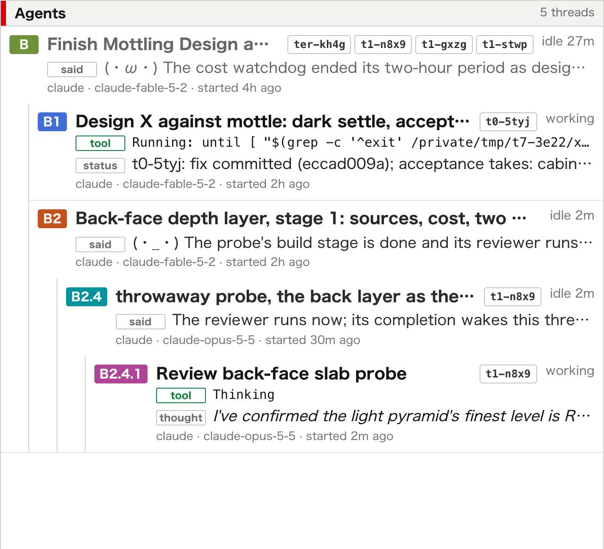

### Cross-highlighting

Every mark on the page belongs to a set of agents: a dot, a route, a card, an event, a map area, an epic, a ticket and a ticket badge. A hover on any mark lights every mark of the same agents in every panel. An agent's own marks light in its color. Shared marks, such as tickets and map areas, light in the color of the hovered agent.

In this screenshot, the pointer rests on agent B's card. Its subagents, its dot and its route light up.

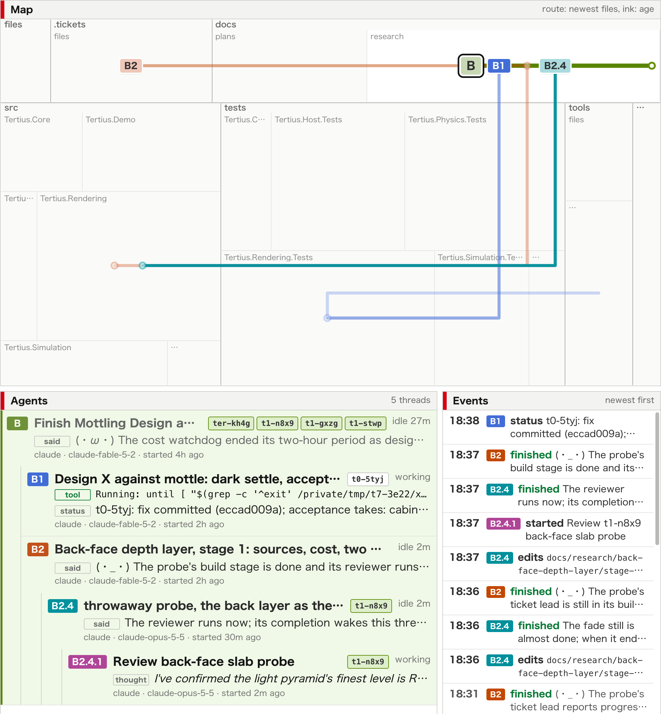

### The directory box

A hover on a map area opens a box with the files in it that agents edited most recently. After each file come its age and the tags of the agents that edited it. Below them, the box lists the 5 largest files of the area by compressed size. A click pins the box.

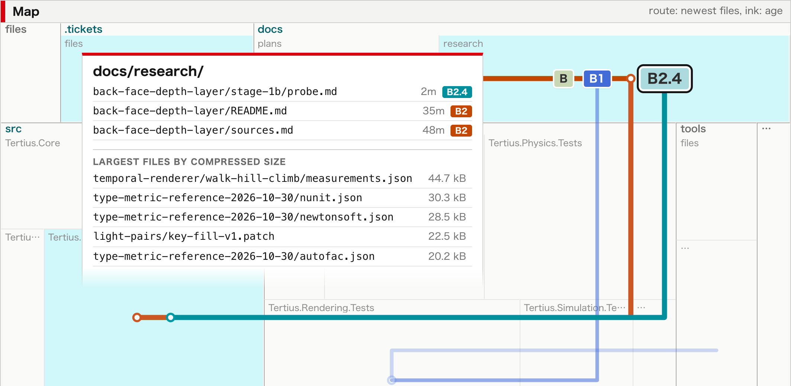

### The event log

The log lists what the agents did, newest first: a thread started, edited files, asked you something, finished, failed, or posted a status line. An event of the last minute has a red time.

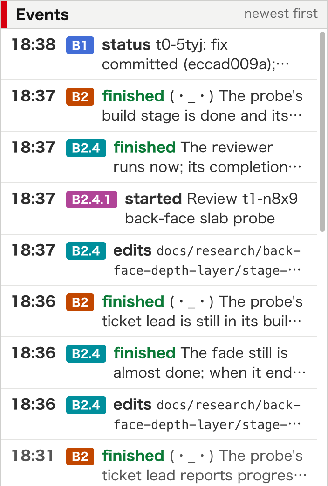

### Status lines over MCP

agentmap is also an MCP server with one tool, `set_status`. Agents post a short status line after each major step. The line shows on the agent's card and in the event log.

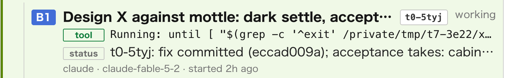

### The ticket strip

agentmap reads the [tk](https://github.com/wedow/ticket) tickets of the project (`.tickets/*.md`). It also reads the tickets in the worktrees of the threads and in other copies of the project where agents work. The strip at the bottom shows each epic that has a live ticket. A live ticket is a ticket that an agent names, or a ticket in progress that changed in the last 24 hours. Agents often leave a ticket in progress after they stop, so the board trusts the agents over the ticket status.

A column shows the epic's agents, a progress bar, the counts of live, ready, blocked, stale and closed tickets, and its live tickets.

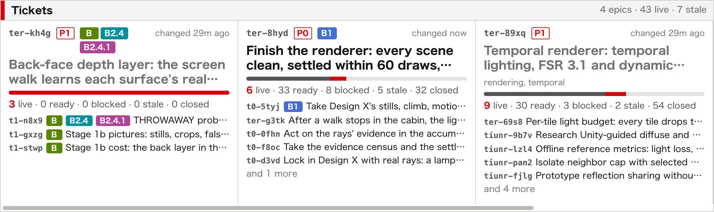

### The ticket list

A click on an epic opens its ticket list in the place of the event log. The list sorts the tickets into tiers, from the bottom up, so the most relevant ticket sits next to the strip:

1. An agent works on it.
2. In progress, and changed in the last 24 hours.
3. Ready.
4. Blocked.
5. Stale claims: tickets in progress that nobody works on. They fold into one line.

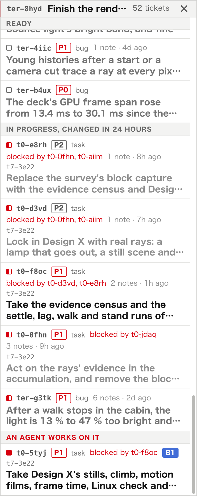

### The ticket box

A hover on a ticket opens a box with its title and description, as on Wikipedia. This works in the list, in the strip and on a card's badges. A click pins the box: it then also shows the ticket's notes, and you can scroll in it. A click on the same ticket, the ✕ button, or Escape closes it.

| Hover | Pinned |
|---|---|
| 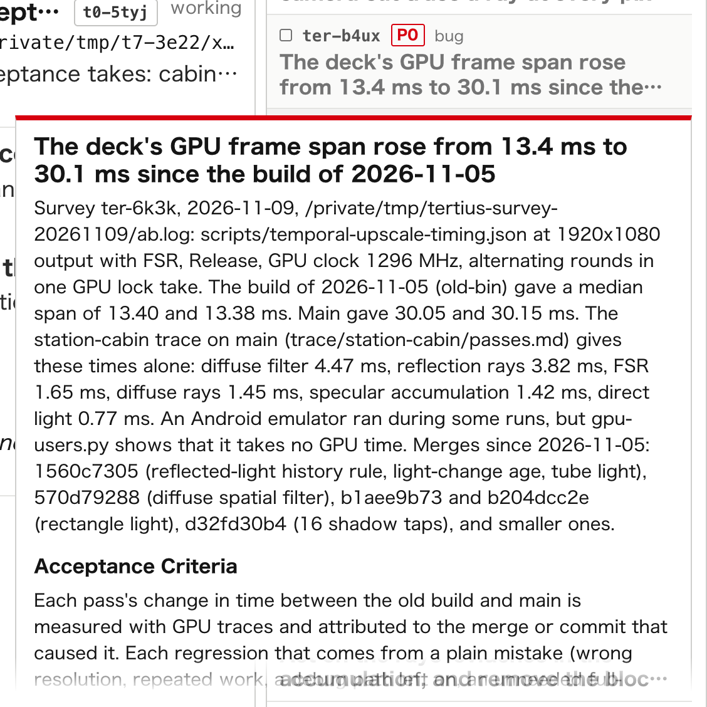 | 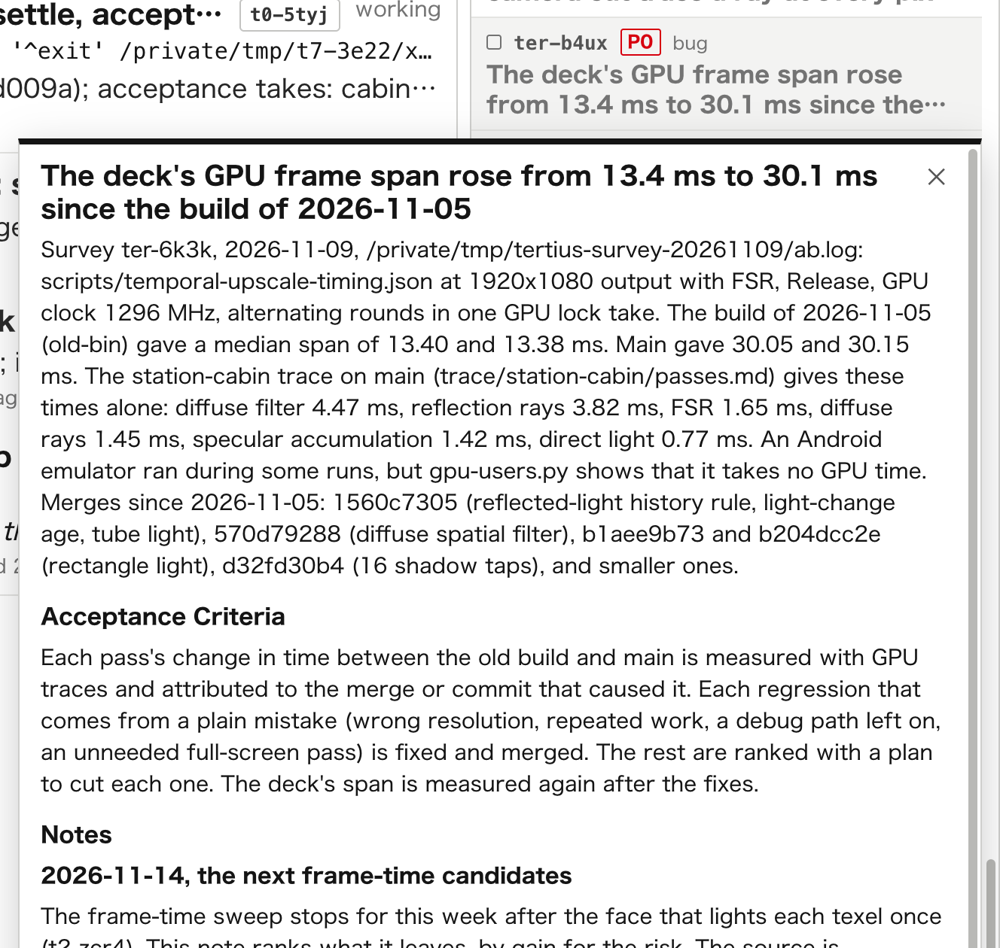 |

### Light and dark themes

The board is light during the day and dark in the evening, by the local clock. The dark theme is a warm dusk gray, not black. Its text keeps the same contrast as the light theme, and each agent keeps its color.

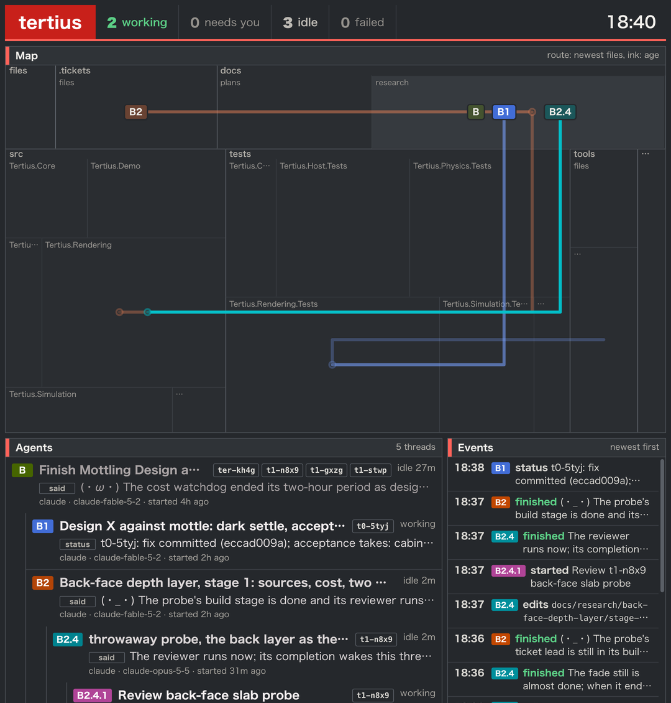

## Install

You need these on the same machine:

- [T3 Code](https://github.com/pingdotgg/t3code). agentmap reads its database (`~/.t3/userdata/statev2.sqlite`), and it only reads.
- Python 3.14 or newer, or [Nix](https://nixos.org). agentmap uses the Python standard library only, so there is nothing to install with pip.
- git, to list the project's files.

Get the code:

```sh
git clone https://github.com/alexispurslane/agentmap.git
cd agentmap
```

If you use Nix, the flake's dev shell gives you the right Python, git and the test tools.

## Run

1. Start the server for one T3 Code project. With Nix:

   ```sh
   nix develop --command python3 -m agentmap --project ~/Development/myproject
   ```

   Without Nix, run the same command with your Python 3.14:

   ```sh
   python3 -m agentmap --project ~/Development/myproject
   ```

2. Open `http://127.0.0.1:7788/` in a browser window on the portrait monitor. The board is made for about 1080 × 1920 CSS pixels.

The server listens on `127.0.0.1` only. It has these options:

| Option | Default | Meaning |
|---|---|---|
| `--project PATH` | none, required | The root of the T3 Code project to show. |
| `--port N` | `7788` | The port on `127.0.0.1`. |
| `--t3-db PATH` | `~/.t3/userdata/statev2.sqlite` | T3 Code's database. |
| `--hours H` | `3` | Show the threads and events of the last `H` hours. |
| `--light-from H` | `7` | The local hour at which the board turns light. |
| `--dark-from H` | `19` | The local hour at which the board turns dark. |

One server shows one project. For a second project, start a second server on another port.

## Use

The board updates itself. These are the things that you can do on it:

| Action | Result |
|---|---|
| Hover over an agent's dot, card or event | Its route, dot, card, events, tickets and map areas light up. |
| Hover over a ticket, an epic or a map area | Its agents light up, each in its own color. |
| Hover over a ticket or a map area | A box opens with the ticket's text or the area's files. |
| Click an agent's title in the tree | The thread opens in the T3 Code app. |
| Click a ticket or a map area | The box stays open (pinned). Click again, click ✕ or press Escape to close it. |
| Click an epic in the strip | Its ticket list opens in the place of the event log. Click ✕ to close it. |
| Click the stale claims line | The folded stale tickets open. |

### Let agents post status lines

The same server is an MCP server at `http://127.0.0.1:7788/mcp`. It has one tool, `set_status`. The tool tells the agents to post a line after each major step. Each line starts with the id of the ticket that the agent works on. The lines go to `.agentmap/status.jsonl` in the watched project. That file is an append-only log.

For Claude Code, add this server to `.mcp.json` in the watched project:

```json
{
  "mcpServers": {
    "agentmap": {
      "type": "http",
      "url": "http://127.0.0.1:7788/mcp",
      "headers": { "X-T3-Thread": "${T3CODE_THREAD_ID}" }
    }
  }
}
```

T3 Code sets `T3CODE_THREAD_ID` in each Claude Code process that it starts. Claude Code puts the value in the header, so the dashboard knows which thread calls.

For Codex, add this server to `~/.codex/config.toml`:

```toml
[mcp_servers.agentmap]
url = "http://127.0.0.1:7788/mcp"
```

All Codex threads in T3 Code share one process, so Codex cannot send a thread header. Instead, the dashboard finds the call in T3 Code's records. A Codex call can therefore wait up to 2 seconds. If two Codex threads make the same call at the same moment, one of them gets an error that asks it to call again.

Keep the server name `agentmap` in both configurations. The dashboard looks for tool calls under that name.

## Run the tests

```sh
nix develop --command python3 -m unittest
```

Coverage and mutation testing also run in the dev shell:

```sh
nix develop --command bash -c 'coverage run --branch -m unittest && coverage report -m'
nix develop --command bash -c 'rm -rf mutants && mutmut run && mutmut results'
```

The design documents are in [docs/plans](docs/plans).

## Limits

- agentmap reads tables that T3 Code uses internally. A new T3 Code version can change them. The reader's tests show which fields it uses.
- The map sizes the files that git tracks, plus new files that git does not ignore. It builds the map again every 10 minutes.
- The light and dark hours are fixed and do not follow the seasons.

## Built with

agentmap is a Python 3.14 server that uses the standard library only: `http.server` for the page and the event stream, `sqlite3` to read T3 Code's database, and `zlib` to weigh the files. It renders HTML with [chevron](https://github.com/noahmorrison/chevron), a Mustache engine that the repository includes. The page uses [Datastar](https://data-star.dev) 1.0.5 for its signals and its live updates over server-sent events, and plain CSS with anchor positioning and OKLCH colors. A Nix flake holds the development environment.

agentmap is free software under the [0BSD license](LICENSE). The included chevron keeps its MIT license.
